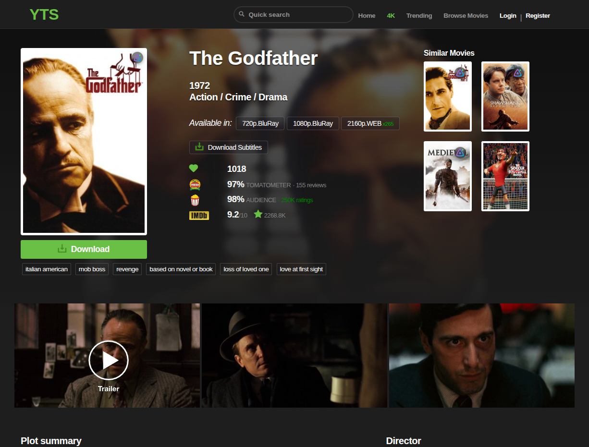
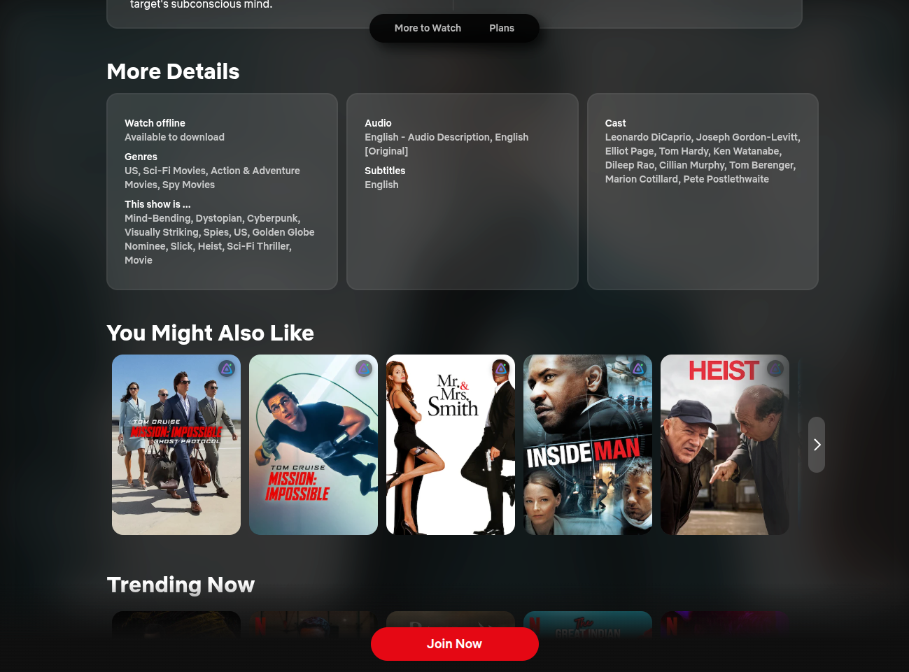
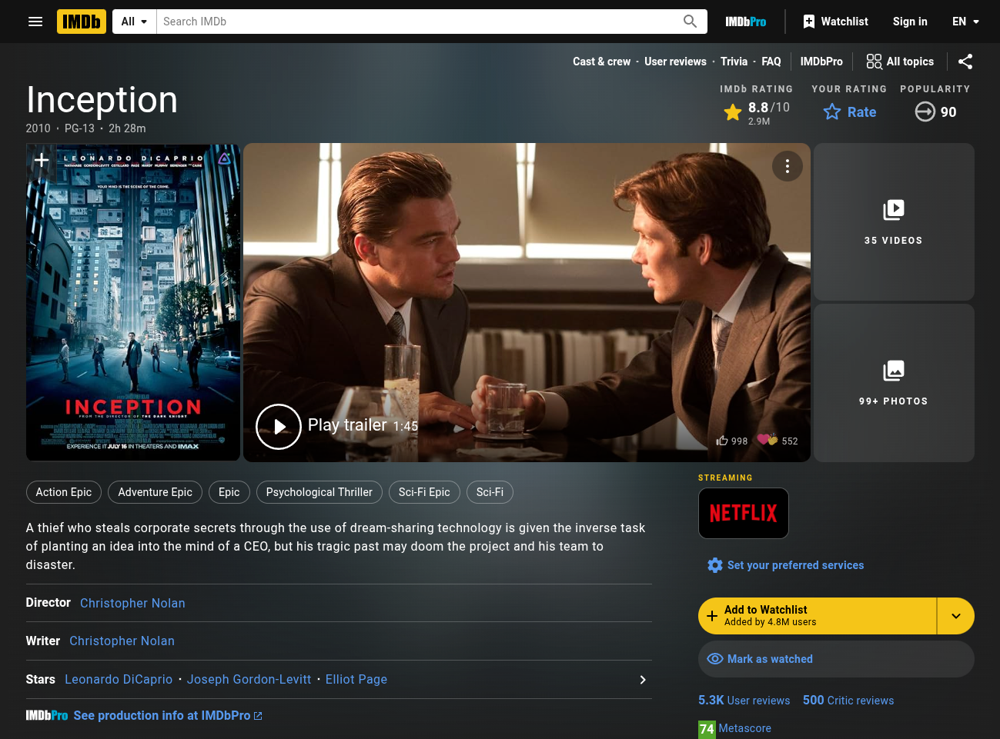
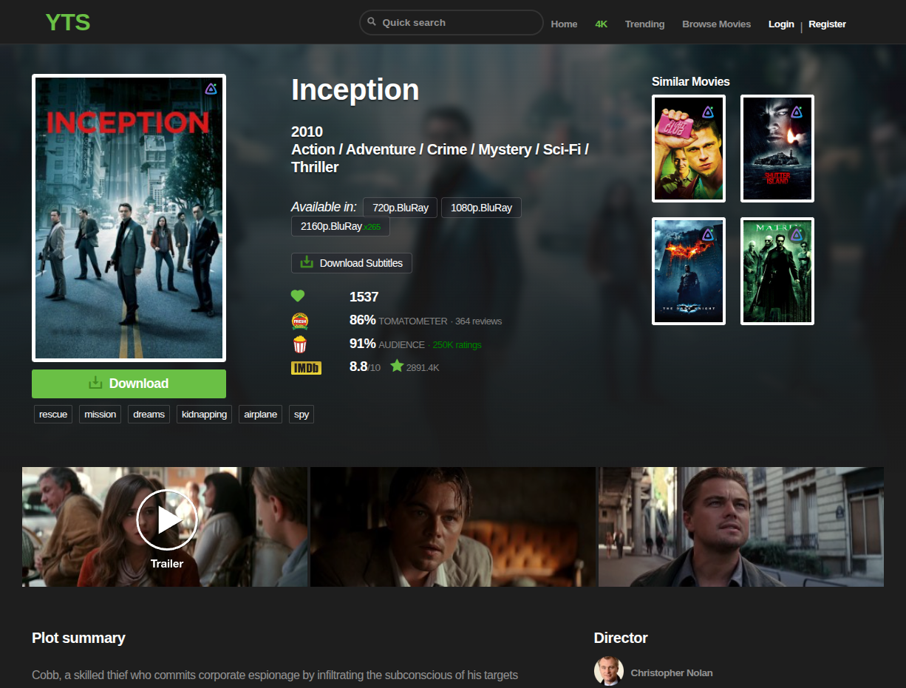
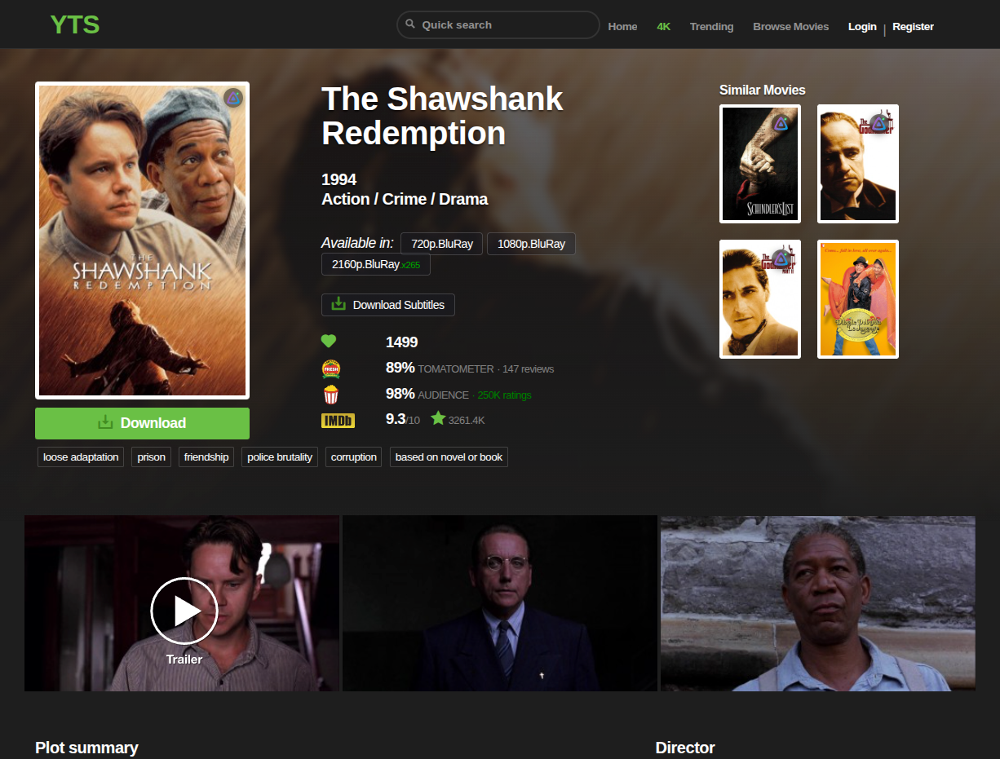

# Do I Have This Movie?

[](LICENSE)
[](manifest.json)
[](https://github.com/kmmuntasir/do-i-have-this-movie/actions/workflows/ci.yml)

A Chrome extension that tells you, right on the page, whether a movie you are looking at is already in your personal media server.

Browse Netflix, IMDb or YTS as usual. A small badge appears on every title that exists in your Jellyfin, Emby or Plex library. No more searching your library by hand before you download or watch something.

> **Disclaimer:** this is a convenience tool for organizing a personal media collection. It only compares titles on a web page with a library you already run. It does not download, stream, host or link to any content, and it does not promote or encourage piracy. YTS and similar sites are supported only because their page layouts are popular for browsing movie listings; you are responsible for complying with the laws and terms of service that apply to you.

## Features

- **Badges on posters.** Movies already in your library get a marker on browse pages, search results, detail pages and "similar movies" lists.
- **Multiple servers.** Jellyfin, Emby and Plex. Enable any combination; sources are queried in parallel.
- **Fuzzy matching.** Matches by title and year, tolerating punctuation, casing and subtitle differences.
- **Works with dynamic pages.** Picks up content that loads while you scroll or navigate.
- **Private.** Credentials stay in your browser, unless you opt in to syncing settings through your Chrome account. The only network requests go to the servers you configure. See [PRIVACY.md](PRIVACY.md).



<details><summary>More screenshots</summary>






</details>

## Supported websites

| Website | Domains |
|---------|---------|
| Netflix | `netflix.com` |
| IMDb | `imdb.com` |
| YTS | `yts.pw`, `yts-official.am`, and older mirrors (`yts.gg`, `yts.bz`, `yts.mx`, `yts.lt`, `yts.am`, `yts.rs`) |

Want another site? See [Adding new websites](docs/adding-new-websites.md). Adapters are small.

## Supported media servers

| Server | Status |
|--------|--------|
| Jellyfin | Supported |
| Emby | Supported |
| Plex | Supported |
| Local files | Supported: pick a folder in settings; file names are indexed locally |

## Install

**From the Chrome Web Store:** _link coming soon._

**From source:**

```bash
git clone https://github.com/kmmuntasir/do-i-have-this-movie.git
cd do-i-have-this-movie
npm install
npm run build
```

Open `chrome://extensions`, enable **Developer mode**, click **Load unpacked** and select the project folder.

Or download the zip from the [Releases](https://github.com/kmmuntasir/do-i-have-this-movie/releases) page, unzip it, and load that folder.

## Configure

1. Click the extension icon, then **Open Settings**.
2. Enable a source and enter its server URL and API key or token. For Local Files, click **Choose folder…** instead.
3. Click **Test Connection**, then **Save**. Chrome asks once to allow access to your server's address.

Details per server: [Setup guide](docs/setup-guide.md).

## How it works

- `content.js` (bundled to `dist/content-bundled.js`) runs on supported sites. A per-site adapter in `adapters/` finds movie cards and extracts title and year.
- `background.js` receives those titles and queries each enabled source adapter in `sources/`.
- On a match the content script injects the badge.

More in [Architecture](docs/architecture.md).

## Development

```bash
npm install
npm run build      # bundle content script into dist/
npm run package    # build and create do-i-have-this-movie-<version>.zip
```

Reload the extension at `chrome://extensions` after each build. See [Build process](docs/build-process.md) and [CONTRIBUTING.md](CONTRIBUTING.md).

## Documentation

[Installation](docs/installation.md) · [Setup](docs/setup-guide.md) · [Architecture](docs/architecture.md) · [Adding websites](docs/adding-new-websites.md) · [Build process](docs/build-process.md) · [Troubleshooting](docs/troubleshooting.md) · [Roadmap](docs/future-enhancements.md)

## Contributing

Bug reports, site adapters and new source adapters are welcome. Read [CONTRIBUTING.md](CONTRIBUTING.md) first.

## License

[GPL-3.0](LICENSE). Not affiliated with Netflix, IMDb, YTS, Jellyfin, Emby or Plex. See the disclaimer above.
